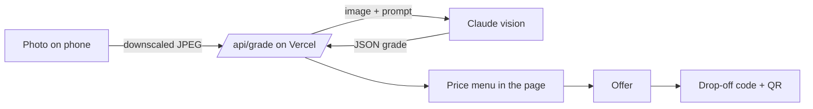

# second look

One photo gives a guaranteed price to repair or trade in a Zara garment, shown at the moment a customer is about to buy new.

Built by Nick Dev, Smaran Kudapa and Nived Nandakumar for the BIC × ZARA Case Competition 2026 ("How can we give garments a second life?").

## What it does

| Screen | What happens |
| --- | --- |
| Scan | Take a photo of a garment, or tap one of three sample pieces |
| Read | Claude identifies the item, grades its condition (A, B or C) and finds the damage |
| Offer | Three priced paths: repair with a ready date, trade-in credit (1.5× if spent on Pre-Owned or repair), or buy new for comparison |
| Book | A drop-off code and QR to show at any Zara till |

## Run it

1. Import this repo into Vercel (no framework, no build step).
2. Add `ANTHROPIC_API_KEY` under Project → Settings → Environment Variables, then redeploy.
3. Optional: `ANTHROPIC_MODEL` overrides the model (default `claude-sonnet-5-5`, falling back to `claude-haiku-5-5`).

Without a key the sample pieces still run the whole flow; real photos show a message instead of a fake grade.

## Limits

- Prices are an illustrative menu (zip repair €15, credit about 20% of the new price), not Zara's real prices. Sample results are marked "Demo result".
- No purchase-history match yet: the item is named from the photo alone.
- The drop-off code is generated in the browser; there is no store back end.
- `/api/grade` only accepts calls from this site's own pages, but has no per-user rate limit.
