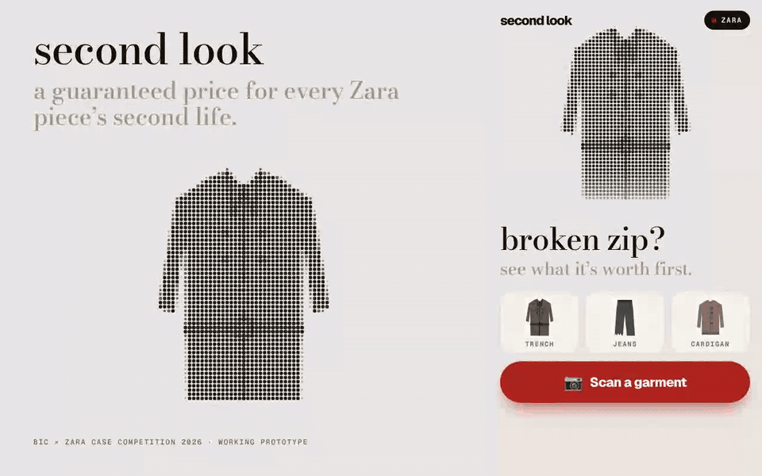
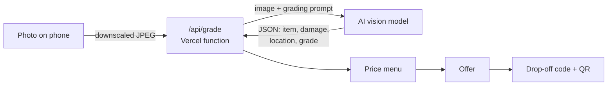

<div align="center">


# Second Look

**Broken zip? See what it's worth first.** Second Look turns one photo of a Zara garment into a guaranteed price to repair it or trade it in, shown right when you're about to buy new.

🧵 **BIC × ZARA Case Competition 2026** · *How can we give garments a second life?*

[Live app](https://second-look-zara.vercel.app) · [How it works](#how-it-works) · [Run it locally](#run-it-locally)

<br>



<sub>The real app at second-look-zara.vercel.app, running the built-in sample trench (marked "Demo result").</sub>

</div>

## What it does

Snap the garment, or tap a sample. In a few seconds you get three guaranteed prices side by side, and one tap books it.

| | |
|---|---|
| **Scan** | Take a photo of the garment on any phone, or tap one of three sample pieces to try it without a camera. |
| **Read** | An AI vision model names the item, finds the damage, marks where it is and grades the condition A, B or C. |
| **Offer** | Repair with a fixed price and a ready date, trade-in credit worth 1.5× if spent on Pre-Owned or repair, and the new item's price for comparison. |
| **Book** | Confirm and get a drop-off code and QR to show at any Zara till. |

## Why it matters

Customers already want a second life for their clothes, but buying new wins on certainty, speed and effort:

| | Today | With Second Look |
|---|---|---|
| **Price known upfront** | Only after searching | Yes, guaranteed |
| **Time to an answer** | Repair back in up to 10 days; resale pays after the buyer confirms | Ready date shown; credit right away |
| **Steps for the customer** | 4 to 6 | 1 photo |

And it's cheap for Zara: €14 of trade-in credit costs about €5.84 in goods at Inditex's 58.3% gross margin, because the value is spent back in store.

<sub>Sources: Zara Help Centre (repair and resale terms), WWD and Marie Claire UK (repair turnaround), Fibre2Fashion (Inditex FY2025 gross margin). Full sources are in our case deck.</sub>

## How it works



- **The model grades, the rules price.** The model only returns a grade. A fixed menu turns that grade into the quote, so the same garment always gets the same guaranteed price.
- **One page, one function.** `index.html` carries its own fonts and QR library. `api/grade.js` sends the photo to the model, only accepts calls from the site's own pages, caps image size, and falls back to a second model if the first is down.
- **It can't fail on stage.** With no API key, the samples still run the whole flow, and a real photo shows "Live grading isn't switched on yet" instead of a made-up grade.

## Run it locally

```bash
git clone https://github.com/nick-devvv/second-look
cd second-look
python3 -m http.server 8000   # http://localhost:8000
```

That runs the sample garments with no keys. For live photo grading, import the repo into Vercel (no framework, no build step) and add:

```bash
ANTHROPIC_API_KEY=your-anthropic-key
ANTHROPIC_MODEL=claude-sonnet-5-5   # optional; falls back to claude-haiku-5-5
```

`GET /api/grade` returns `{"live": true}` once the key is set.

## Built with

Anthropic API (vision) · Vercel Functions · vanilla JS and canvas halftone printing · Geist and Bodoni Moda · qrcode-generator

## Team

[Nick Dev](https://github.com/nick-devvv) (Economics) · [Smaran Kudapa](https://github.com/SmaranKudapa) (Computer Science) · Nived Nandakumar (CS + Math), all at UC Berkeley

<sub>Prices are illustrative, not Zara's: zip repair €15, credit about 20% of the new price (the Patagonia Worn Wear benchmark), and the 1.5× bonus is our proposal. The drop-off code is generated in the browser; there is no store back end yet. Independent student work, not affiliated with, prepared for, reviewed or endorsed by Zara or Inditex.</sub>
